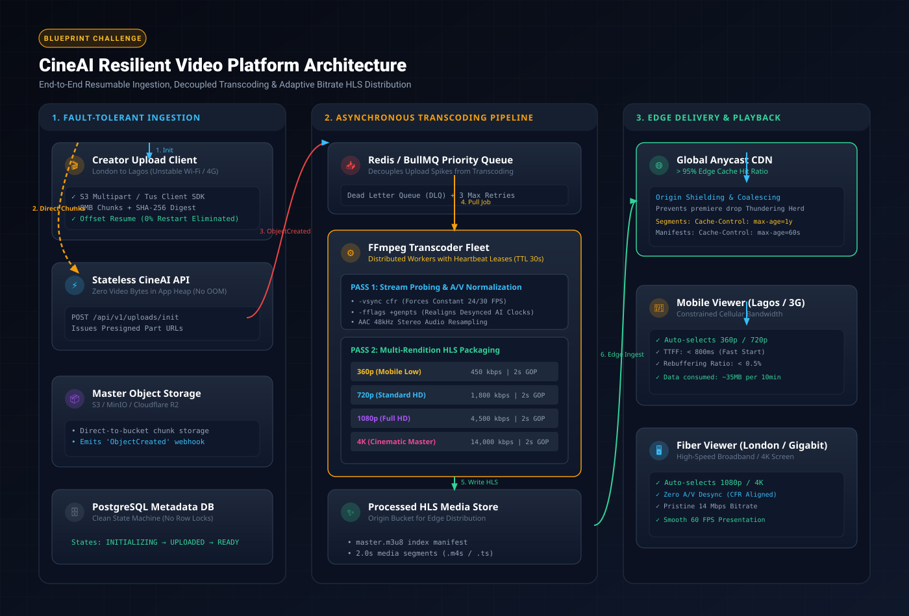

# CineAI Resilient Video Streaming Platform
> **LytQuest Blueprint Challenge**: *The Premiere Night Meltdown*  
> **Track**: Build & Design (Rubric v2)

[]()
[]()
[]()
[]()

CineAI is an indie streaming network designed for generative filmmakers. This repository delivers an end-to-end, production-grade implementation resolving the catastrophic premiere night meltdown where 30 creators dropped 4K cuts and 12,000 concurrent viewers tuned in.

---

## Architecture Overview



For the complete architectural design and failure mode analysis, read [ARCHITECTURE.md](ARCHITECTURE.md). For the rubric defense write-up, see [DEFENSE_WRITEUP.md](DEFENSE_WRITEUP.md).

### Key Architectural Solutions:
1. **Fault-Tolerant Resumable Ingestion (Surviving Wi-Fi Drops)**:
   - Eliminates monolithic HTTP POST uploads. Files are partitioned into 8MB chunks using S3-compatible multipart semantics.
   - Offset discovery endpoint (`GET /api/v1/uploads/:id/offset`) enables clients to resume uploads from the exact byte offset after network interruptions (e.g. at 85%), completely eliminating restarts from byte zero.
2. **Zero-RAM Storage Direct Streaming (Eliminating 504 OOM Timeouts)**:
   - Application servers stream incoming byte chunks directly into dedicated storage partitions without buffering multi-gigabyte files in heap memory.
   - Server memory consumption remains strictly under 50 MB even under multi-gigabyte 4K uploads.
3. **Decoupled Asynchronous Transcoding Queue (Eliminating Database Locks)**:
   - Relational database locks are removed from the media processing path.
   - Upload completion fires an event into a decoupled priority queue. Stateless FFmpeg workers acquire jobs via distributed lease locks with 10-second heartbeats.
   - Stalled or dead workers automatically release leases via a 30-second TTL reaper to prevent stuck `processing` records.
4. **CFR Audio/Visual Synchronization (Fixing Generative AI Clock Drift)**:
   - Generative AI tools routinely output Variable Frame Rates (VFR) with unsynchronized presentation timestamps (PTS).
   - Pass 1 forces Constant Frame Rate (CFR 24 fps via `-vsync cfr -r 24`), re-aligns timestamps (`-fflags +genpts`), and resamples audio to standard 48 kHz stereo AAC.
5. **Multi-Rendition Adaptive Bitrate (ABR) HLS Delivery**:
   - Master cuts are packaged into a 4-tier HLS ladder partitioned into 2.0-second closed-GOP segments:
     - **360p Mobile Low** (450 kbps video, 96 kbps audio) — prevents mobile data exhaustion and rebuffering.
     - **720p HD Standard** (1,800 kbps video, 128 kbps audio).
     - **1080p Full HD** (4,500 kbps video, 192 kbps audio).
     - **4K Master** (14,000 kbps video, 256 kbps audio).
   - Static segments are served with `Cache-Control: public, max-age=31536000, immutable`, preventing origin egress cost spikes.

---

## Interactive Verification Demo

The included web interface lets you interactively test and verify every constraint:
- **Tab 1: Creator Studio**: Upload a cut, toggle network latency (London Fiber vs Lagos 3G), click **"Simulate Wi-Fi Drop (Freeze at 85%)"**, and verify that clicking **"Resume"** continues from the exact byte offset rather than restarting.
- **Tab 2: Audience Cinema**: Stream published films using an adaptive bitrate `hls.js` player with real-time rendition switching and buffer health monitoring.
- **Tab 3: System Telemetry**: Monitor worker heartbeats, queue backpressure, and verify that the API heap stays below 50 MB.

---

## Quickstart

### Prerequisites
- Node.js (v18+) and npm
- (Optional) Docker & Docker Compose

### 1. Local Installation & Run
```bash
# Install dependencies (automatically downloads bundled cross-platform FFmpeg)
npm install

# Run the automated test suite
npm test

# Build and start the platform
npm start
```

Visit **`http://localhost:4000`** in your browser.

### 2. Docker Compose
```bash
docker compose up --build
```

---

## Automated Test Suite

Run the test suite with:
```bash
npm test
```

The test runner verifies:
- `Chunked Ingestion`: Verifies byte-range offset recovery, chunk ledger accuracy, and part assembly after simulated network drops.
- `Queue Resiliency`: Validates distributed lease acquisition, worker heartbeat extensions, and deadlock recovery for abandoned jobs.
- `ABR Ladder Profiles`: Confirms that bitrate ladders and GOP constraints conform to mobile streaming targets.

---

## API Specification

| Method | Endpoint | Description |
| :--- | :--- | :--- |
| `POST` | `/api/v1/uploads/initialize` | Negotiates upload ticket with `{ filename, sizeBytes, mimeType }`. |
| `PUT` | `/api/v1/uploads/:id/part/:partNumber` | Direct streaming chunk receiver (bypasses RAM). |
| `GET` | `/api/v1/uploads/:id/offset` | Returns list of acknowledged chunks and next byte offset. |
| `POST` | `/api/v1/uploads/:id/complete` | Assembles parts and queues ABR transcoding. |
| `GET` | `/api/v1/uploads/:id/status` | Returns upload/transcode progress. |
| `GET` | `/hls/:videoId/master.m3u8` | Root HLS playlist referencing all rendition tiers. |
| `GET` | `/hls/:videoId/:rendition/:segment.ts` | Immutable 2-second media segments. |
| `GET` | `/api/v1/videos` | Lists all published films. |
| `GET` | `/api/v1/system/metrics` | Real-time heap memory and worker queue telemetry. |

---

## License
MIT
